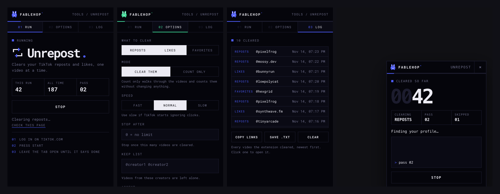

<h1 align="center">Fablehop Unrepost</h1>

  A browser extension that clears your TikTok reposts, likes and favorites for you. 
  Works in Brave, Chrome, Edge and Firefox. Made by <a href="https://github.com/slizsy">slizsy</a>.

  

Press start and it opens your profile, goes to the tab you picked, and clears each video one by one. A small panel on the page counts them as they go. When TikTok stops showing videos it reloads and looks again, several times, before it decides you're really done.

## What it does

| | |
|---|---|
| **Reposts, likes, favorites** | Pick one or more in Options. They are cleared in that order. |
| **Keeps searching** | TikTok often shows an empty tab while more are left. The extension reloads and checks again before it stops. |
| **Count only** | Walks through the videos and counts them without changing anything. Good for a first try. |
| **Stop after** | Clear a set number of videos, then stop. |
| **Keep list** | Videos from creators on this list are left alone. |
| **Log** | Every video it cleared, with a link back to it. Copy the links or save them as a text file. |
| **Speed** | Fast, normal or slow. Use slow if TikTok starts ignoring the clicks. |
| **Toolbar count** | The icon shows a live count while it runs. |
| **Shortcut** | `Alt+Shift+U` starts or stops a run on the TikTok tab. |
| **Accent colors** | Blue, mint, pink or amber. |
| **Page check** | Shows what the extension can see on the page, for when a run gets stuck. |

## Install

Download the zip for your browser from the [latest release](https://github.com/slizsy/Fablehop/releases/latest) and unzip it.

**Brave / Chrome / Edge**

1. Go to `brave://extensions` (or `chrome://extensions`)
2. Turn on **Developer mode** (top right)
3. Click **Load unpacked** and pick the unzipped `brave` folder

**Firefox** (127 or newer)

1. Go to `about:debugging#/runtime/this-firefox`
2. Click **Load Temporary Add-on**
3. Pick `manifest.json` inside the unzipped `firefox` folder

Firefox forgets temporary add-ons when it closes, so you load it again next time you need it.

## Use

1. Log in on [tiktok.com](https://www.tiktok.com)
2. Click the Fablehop icon in the toolbar and press **Start**
3. Leave the tab open until the panel says done

Clearing can't be undone in bulk. If you're unsure, run **Count only** first, or set **Stop after** to a small number.

## How it's laid out

- `brave/`: the extension for Brave, Chrome and Edge
- `firefox/`: the same extension for Firefox

Each folder is the whole extension, ready to load as it is. Plain HTML/CSS/JS, nothing to build. The two only differ in `manifest.json`, so a change to any other file should be made in both.

It finds TikTok's buttons by their names in the page. If TikTok changes its layout and something stops working, the names to update are in the `TARGETS` list near the top of `content.js`.

It only runs on tiktok.com, and nothing leaves your browser.
